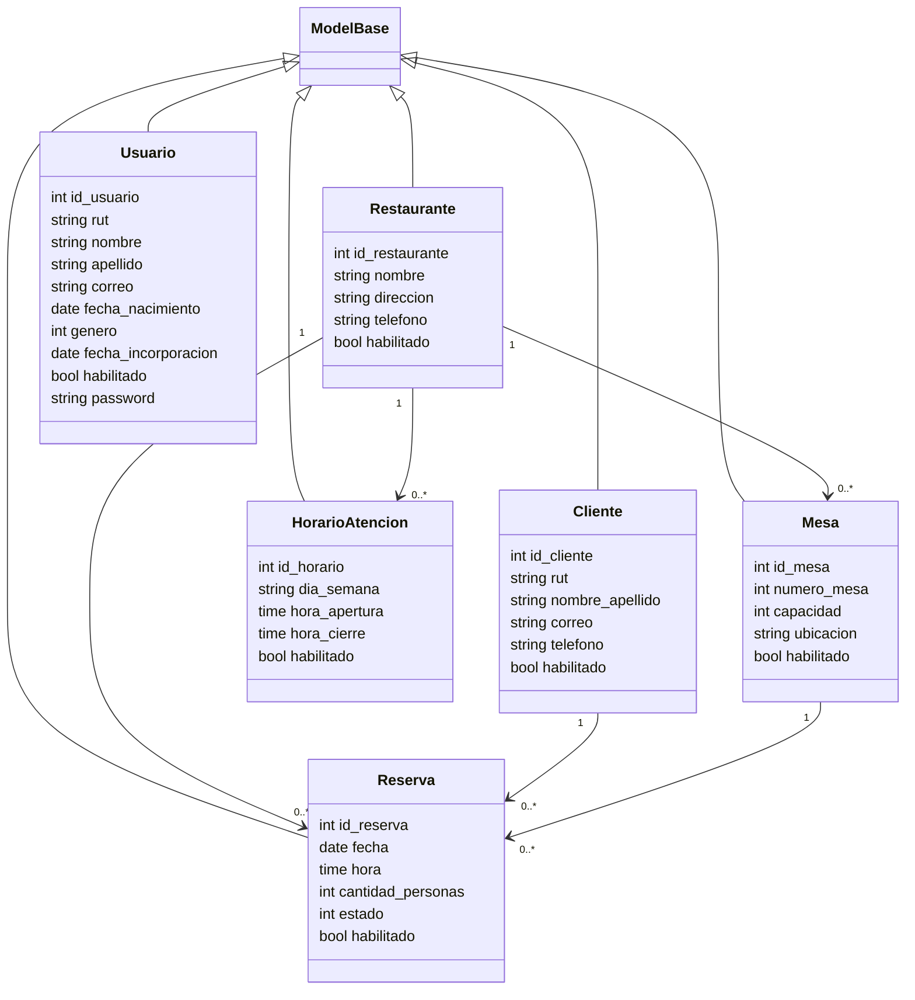

# Sistema de Gestión y Reservas de Restaurantes (POO)

Sistema de consola en Python para gestionar restaurantes, clientes, mesas, reservas, usuarios y horarios de atención. Implementa POO, arquitectura por capas y persistencia con Peewee sobre MySQL.

## Integrantes

- Angela Perozo
- Ruth Arias
- David Parra

## Características Principales

- Gestión CRUD de restaurantes y clientes.
- Gestión CRUD de mesas asociadas a restaurantes.
- Gestión de reservas: creación, modificación, cancelación y validación de capacidad.
- Estado de reserva: `1 = Reservada`, `2 = Cancelada`, `3 = Completada`.
- Gestión CRUD de usuarios y horarios de atención.
- Validación de RUT, correo y contraseña; las contraseñas de usuario se almacenan con bcrypt.
- Inicio de sesión obligatorio con maskpass y bcrypt.
- Interfaz Visual en Consola: Despliegue de tablas formateadas mediante `PrettyTable`.

## Arquitectura del Sistema

El proyecto implementa una arquitectura multicapa con separación limpia de responsabilidades:

1. Capa de Presentación (`presentacion/`): Módulos interactivos en consola (`PrettyTable` y menús).
2. Capa de Negocio (`negocio/`): Contiene la lógica, reglas de validación y flujos de trabajo.
3. Capa de Datos (`datos/`):
   - Modelos (`datos/modelos/`): Clases ORM mapeadas a las tablas de MySQL mediante Peewee.
   - Repositorios (`datos/repositorio/`): Encargados de las operaciones CRUD directas hacia la base de datos.
4. Módulos Auxiliares (`auxiliares/`): Helpers de formato, mensajes globales y utilidades.

### Diagrama de clases actual

La imagen de la Evaluación 2 se conserva en el repositorio. Este diagrama muestra los modelos ORM actuales, incluido Usuario:



## Tecnologías y Librerías

- Lenguaje: Python 3.12
- Base de Datos: MySQL
- ORM: Peewee
- Conector DB: PyMySQL
- Librerías Adicionales:
  - `prettytable`: Para el formato de tablas en consola.
  - `python-decouple`: Para leer la configuración desde variables de entorno (`.env`).
  - `bcrypt`: Para generar hashes seguros de contraseñas.
  - `maskpass`: Para ocultar las contraseñas durante el ingreso.

## Instalación

1. Crear y activar un entorno virtual de Python.
2. Instalar dependencias: `pip install -r requirements.txt`.
3. Crear una base de datos MySQL vacía.
4. Completar el archivo `.env` de la raíz con los datos de conexión a MySQL:

```text
db=nombre_base_datos
host=localhost
port=3306
user=usuario_mysql
password=contraseña_mysql
```

5. Ejecutar `datos/sql/01_crear_tablas.sql` para crear las tablas.
6. Ejecutar `datos/sql/03_insert_usuarios.sql` para insertar el usuario de demostración.

## Ejecución

Desde la raíz del proyecto:

```powershell
python main.py
```

La aplicación solicita correo y contraseña antes de mostrar el menú principal.

### Usuario de demostración

Después de ejecutar el script de usuarios iniciales, se puede iniciar sesión con:

- Correo: `demo.usuario@example.com`
- Contraseña: `Demo2026!`

La contraseña se guarda como hash BCrypt en la base de datos. Este usuario es solo
para pruebas y puede cambiarse o eliminarse desde la gestión de usuarios.
